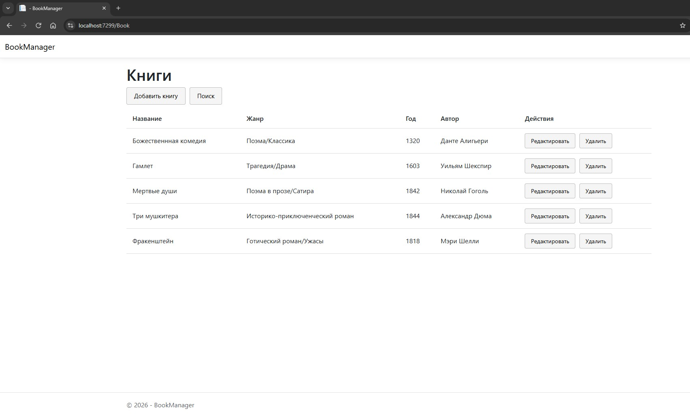
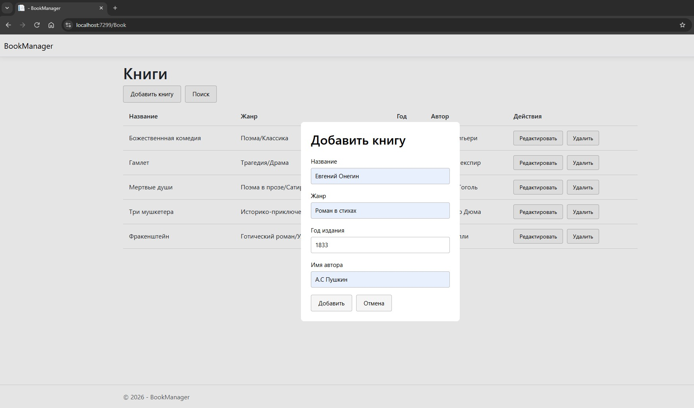
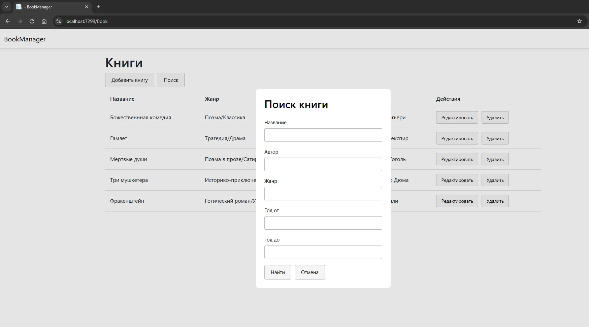

BookManager

Учебное веб-приложение для управления книгами и авторами, разработанное на C# с использованием ASP.NET Core MVC.

О проекте

BookManager позволяет работать с каталогом книг и информацией об авторах. Проект создан для практического изучения разработки веб-приложений, работы с реляционными базами данных и реализации CRUD-операций.

Функциональность

Просмотр списка книг.

Добавление книг.

Редактирование книг.

Удаление книг.

Поиск книг по заданным параметрам.

Сортировка книг по названию в алфавитном порядке.

Работа с информацией об авторах.

Валидация пользовательского ввода.

Проверка обязательных полей и корректности года издания.

Работа со связанными сущностями «Книга» и «Автор».

Использование модальных окон для добавления и редактирования книг.

Технологии

C#

ASP.NET Core MVC

Entity Framework Core

PostgreSQL

Npgsql

LINQ

Razor Views

HTML, CSS, JavaScript

Data Annotations

Архитектура и реализация

MVC для организации приложения.

Модели для представления книг и авторов.

Связь между книгами и авторами.

Атрибуты валидации для проверки пользовательского ввода.

Entity Framework Core для доступа к данным.

LINQ для запросов, фильтрации и сортировки.

Скриншоты приложения

## Скриншоты приложения

### Список книг

### Добавление книги

### Поиск книг

Запуск проекта

Установить подходящий .NET SDK и PostgreSQL.

Клонировать репозиторий:

git clone https://github.com/Boobonick89/BookManager.git

Открыть решение в Visual Studio.

Настроить строку подключения к PostgreSQL.

Восстановить NuGet-пакеты.

Применить миграции Entity Framework Core, если они предусмотрены проектом.

Запустить приложение.

Не публикуйте пароли и другие секретные данные в репозитории.

Статус

Учебный проект для практики разработки веб-приложений на C# и ASP.NET Core MVC.
